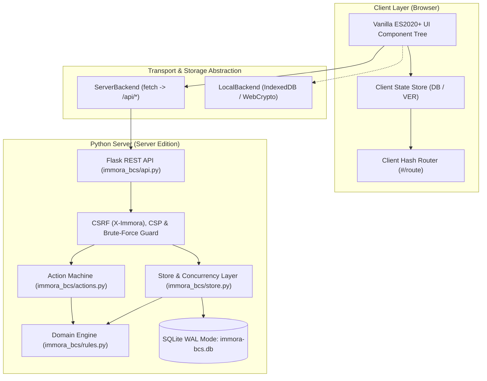
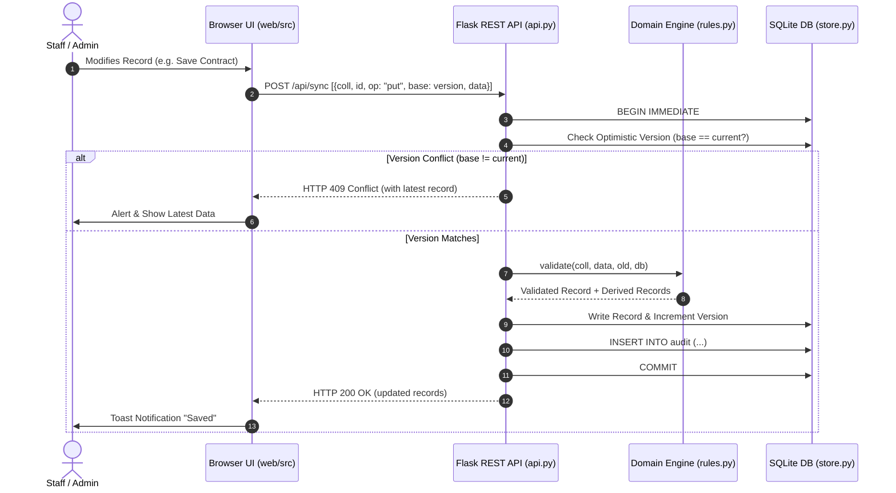
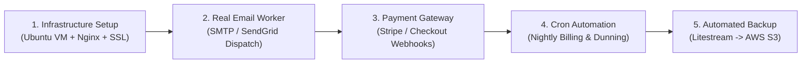

# Immora BCS — System Architecture & Production Deployment Documentation

**Version:** 1.0.0  
**Target Domain:** Coworking spaces, serviced business centres, shared offices, executive suites, and commercial lease operators  
**Primary Market Localization:** United Arab Emirates (AED, 5% VAT, 15-digit TRN, FTA-compliant Tax Invoices, Ejari-ready contract fields) + Multi-country presets (Saudi Arabia, Bahrain, Oman, UK, India, International)

---

## Table of Contents
1. [Executive Summary](#1-executive-summary)
2. [High-Level Architecture](#2-high-level-architecture)
3. [Technology Stack](#3-technology-stack)
4. [Functional Modules & Domain Rules](#4-functional-modules--domain-rules)
5. [Backend & UI Integration Audit](#5-backend--ui-integration-audit)
6. [Simulated Features vs. Real-World Gaps](#6-simulated-features-vs-real-world-gaps)
7. [Production Deployment Roadmap](#7-production-deployment-roadmap)
8. [Administration & Operational Maintenance](#8-administration--operational-maintenance)

---

## 1. Executive Summary

**Immora BCS** is a self-contained, vertical ERP and business centre management system. It models the entire operational lifecycle of flexible office spaces: space inventories, visual floor plans, room bookings, credit quota tracking, CRM lead pipelines, commercial leases, virtual offices, recurring billing runs, FTA-compliant tax invoices, and visitor check-ins.

### Dual-Edition Paradigm
The platform is built on a unified codebase that compiles into two independent runtime editions:
* **Server Edition (Multi-User):** Powered by Python 3.10+, Flask 3, Waitress WSGI, and SQLite with WAL mode. Provides a hardened REST API (`/api/*`), role-based access control, PBKDF2 authentication, and optimistic concurrency control.
* **Offline Edition (Single-File):** A standalone 873 KB HTML file (`Immora-BCS.html`) with inlined CSS, base64 fonts, vendor libraries, seed data, and a browser-local database engine powered by IndexedDB and WebCrypto PBKDF2.

> [!NOTE]
> Business rules live in strict parity between Python (`immora_bcs/rules.py`) and JavaScript (`web/src/02-rules.js`). Validations, pricing, proration, and tax calculations behave identically across both editions.

---

## 2. High-Level Architecture



---

## 3. Technology Stack

### 3.1 Backend (Server Edition)
* **Runtime:** Python 3.10+ (tested on Python 3.12).
* **Web Framework:** Flask 3.x (`flask>=3.0,<4`) using Blueprint routing.
* **WSGI Production Server:** Waitress 3.x (`waitress>=3.0`) multi-threaded runner (default 8 worker threads).
* **Database Engine:** SQLite 3 standard library with:
  * `PRAGMA journal_mode = WAL` (Write-Ahead Logging).
  * `PRAGMA foreign_keys = ON`.
  * Optimistic Concurrency Control (OCC) using monotonic sequencing (`seq`) and record versions (`version`).
* **Cryptography & Auth:**
  * PBKDF2-HMAC-SHA256 (200,000 iterations, 16-byte cryptographically secure salt).
  * Constant-time hash verification via `hmac.compare_digest`.
  * 5-attempt brute-force lockout with 5-minute cooldown.
* **Timezone Database:** `tzdata` + standard library `zoneinfo` (default centre timezone: `Asia/Dubai`).

### 3.2 Frontend (Client-Side)
* **Core Language:** Vanilla JavaScript (ES2020+), zero external UI frameworks (no React, Vue, Angular, or Node.js runtime required).
* **Styling & Layout:** Pure CSS3 with CSS custom properties (variables), Flexbox, CSS Grid, Light/Dark color schemes, and full right-to-left (`dir="rtl"`) layout mirroring for Arabic and Urdu.
* **Embedded Assets:** Inter, Noto Sans Arabic, and Noto Sans Devanagari fonts embedded directly as Base64 WOFF2 strings (100% offline, zero Google Fonts or external CDN calls).
* **Visualizations & QR:**
  * Lightweight inline SVG charting engine (`11-charts.js`) for occupancy, revenue, and aged receivables.
  * Kazuhiko Arase’s `qrcode.js` (MIT) vendored for local QR badge and FTA invoice generation.

---

## 4. Functional Modules & Domain Rules

### 4.1 Spaces & Visual Floor Plan (`21-spaces.js`)
* **Space Types:** Hot desks, dedicated desks, private offices, meeting rooms, event spaces, virtual office addresses, parking bays, lockers.
* **Interactive Floor Plan:** SVG-based interactive floor map supporting live drag-and-drop desk/office rearrangement. On pointer release, new coordinates $(x, y)$ are immediately persisted to the backend database.
* **State Engine:** Automatic status derivation (`available`, `occupied`, `reserved`, `maintenance`) driven by active contracts and maintenance notes.

### 4.2 Room Bookings & Credit Quotas (`22-bookings.js`, `rules.py`)
* **Visual Calendar:** Day and week calendar views with live clash detection.
* **Credit Quota Engine:**
  * Every membership plan provides a monthly quota of meeting-room credits (e.g., 8 credits/month for Hot Desk, 12 for Dedicated Desk).
  * Each room has a credit consumption rate (e.g., Boardroom = 4 credits/hour).
  * Bookings automatically consume available credits first.
  * When credits are exhausted, overage hours are calculated and converted into an unbilled pending charge at the room's hourly rate:
    $$\text{Overage Amount} = \left(\frac{\text{Credits Needed} - \text{Credits Remaining}}{\text{Credit Rate}}\right) \times \text{Hourly Price}$$

### 4.3 CRM & Sales Pipeline (`23-crm.js`)
* **Kanban Pipeline:** Stages include `New`, `Contacted`, `Tour`, `Proposal`, `Negotiation`, `Won`, and `Lost`.
* **Lead Conversion:** One-click atomic conversion (`convert_lead`) that moves the lead to `Won`, provisions a company record, creates a member record, and assigns membership plans in a single transaction.
* **Quotations:** Multi-line quotes with automated VAT calculation and PDF print layouts.

### 4.4 Contracts & Lease Management (`24-contracts.js`)
* **Lease Terms:** Fixed-term leases with monthly recurring fees, security deposits, and notice periods.
* **UAE Ejari-Ready Metadata:** Tracks unit numbers, plot numbers, Makani numbers, DEWA premise numbers, and annual rents.
* **Overlap Protection:** Server-side validation guarantees that private offices and dedicated desks cannot be assigned to overlapping active contract dates.
* **Renewal Engine:** Automated renewal workflow applying percentage price escalations:
  $$\text{New Fee} = \text{Old Fee} \times \left(1 + \frac{\text{Uplift \%}}{100}\right)$$

### 4.5 Billing Engine & UAE FTA Tax Invoices (`26-billing.js`, `rules.py`, `actions.py`)
* **Proration Engine:** Day-based proration for contracts starting or terminating mid-month:
  $$\text{Prorated Fee} = \text{Monthly Fee} \times \frac{\text{Active Days in Month}}{\text{Total Days in Month}}$$
* **Consolidated Billing Run:** Sweeps active contracts and appends uninvoiced charges (coffee, extra room hours, printing, catering) into draft invoices.
* **Invoice Immutability:** Once an invoice is issued, its line items, customer details, and tax amounts are **permanently locked**. Revisions require issuing a credit note (`creditnotes`) or voiding with a recorded reason.
* **Sequential Tax Numbering:** Strict format `INV-YYYY-XXXX`.
* **Dunning Automation:** Tracks 1, 14, and 30-day overdue intervals, escalating dunning levels and queueing reminder notices.
* **Accounting Export:** Full JSON and CSV exports compatible with external accounting packages (Immora Books / QuickBooks / Xero).

### 4.6 Front Desk & Access Management (`27-desk.js`)
* **Visitor Registration:** Expected guest pre-registration, check-in timestamps, and printable QR badges.
* **Access Card Logs:** Evaluates member card numbers against active contract validity and logs access outcomes (`granted` vs. `denied`).

---

## 5. Backend & UI Integration Audit

Every screen and form in the user interface connects directly to the Python/Flask backend in Server Edition:



### Complete Integration Matrix

| UI Screen | Source File | API Endpoint | Target Collection | Mutation Mechanism |
|---|---|---|---|---|
| **Floor Plan** | `21-spaces.js` | `POST /api/sync` | `spaces` | Pointer release updates $(x, y)$ coordinates via `save("spaces", ...)` |
| **Spaces & Pricing** | `21-spaces.js` | `POST /api/sync` | `spaces`, `plans`, `products` | CRUD modals calling `save()` and `remove()` |
| **Room Calendar** | `22-bookings.js` | `POST /api/sync` | `bookings`, `charges` | Slot click creates booking; overage creates charge via `save()` |
| **Lead Pipeline** | `23-crm.js` | `POST /api/sync` | `leads` | Dragging card across Kanban stages saves new stage |
| **Lead Conversion** | `23-crm.js` | `POST /api/action/convert_lead` | `leads`, `members`, `companies` | Invokes `actions.convert_lead` |
| **Contracts** | `24-contracts.js` | `POST /api/sync` | `contracts` | Validates lease dates and space conflicts via `save()` |
| **Contract Renewals** | `24-contracts.js` | `POST /api/action/renew_contract` | `contracts` | Invokes `actions.renew_contract` with percentage uplift |
| **Virtual Office** | `25-vo.js` | `POST /api/sync` | `addressuse`, `mail`, `calls` | Logs trade license addresses, mail packages, call notes |
| **Invoicing** | `26-billing.js` | `POST /api/sync` | `invoices` | Drafts, issues, and voids tax invoices |
| **Billing Run** | `26-billing.js` | `POST /api/action/billing_run` | `invoices`, `charges` | Invokes batch billing engine across active contracts |
| **Receipts & Credit Notes**| `26-billing.js` | `POST /api/sync` | `receipts`, `creditnotes` | Updates invoice balances and marks invoices paid |
| **Dunning Reminders** | `26-billing.js` | `POST /api/action/dunning_run` | `invoices`, `outbox` | Evaluates overdue intervals and drafts reminder notices |
| **Front Desk** | `27-desk.js` | `POST /api/sync` | `visitors`, `checkins` | Check-in buttons write daily check-in logs |
| **Card Tap Simulation** | `27-desk.js` | `POST /api/action/card_tap` | `access`, `checkins` | Evaluates card permission and updates daily attendance |
| **Helpdesk** | `28-help.js` | `POST /api/sync` | `tickets` | Ticket creation, status updates, and staff comments |
| **Reports** | `29-reports.js` | `GET /api/state` | Dynamic computation | Computes live occupancy, revenue, and aged receivables |
| **Centre Settings** | `30-admin.js` | `POST /api/sync` | `cfg` | Saves TRN, legal name, bank details, and branding |
| **User Management** | `30-admin.js` | `GET / POST /api/users` | `users` table | Provisions staff accounts and PBKDF2 passwords |
| **Audit Log** | `30-admin.js` | `GET /api/audit` | `audit` table | Streams chronological administrative log |
| **Backup & Restore** | `30-admin.js` | `GET /api/backup`<br>`POST /api/restore` | Full database | Streams JSON backup or executes full database restore |
| **Member Portal** | `31-portal.js` | `GET /api/state`<br>`POST /api/sync` | Scoped by `member_view` | Self-service room booking, ticket creation, guest invitations |

---

## 6. Simulated Features vs. Real-World Gaps

While every screen connects to the Python backend, the backend itself contains three **simulated service placeholders**:

```
┌────────────────────────────────────────────────────────────────────────┐
│ Current Application Boundary                                           │
│                                                                        │
│  [ UI Form / Button ] ──► [ Flask REST API ] ──► [ SQLite DB ]         │
│                                                        │               │
│                                                        ▼               │
│                                             [ Simulated Placeholder ]  │
└────────────────────────────────────────────────────────┼───────────────┘
                                                         │
                                    Need Real Driver?    ▼
                         ┌───────────────────────────────────────────────┐
                         │ 1. Payment Link: https://pay.example.invalid  │
                         │ 2. Email Outbox: Table status="queued"        │
                         │ 3. Card Tap: Simulated RFID event             │
                         └───────────────────────────────────────────────┘
```

1. **Payment Links (`immora_bcs/actions.py:105`):**  
   Generates a placeholder link (`https://pay.example.invalid/...`). Requires integration with an external payment gateway (Stripe, Network International, Checkout.com).
2. **Notification Outbox (`immora_bcs/actions.py:39`):**  
   Dunning notices, mail alerts, and lease reminders are queued in the SQLite `outbox` table. Requires a worker process connected to an SMTP server, SendGrid, AWS SES, or Twilio.
3. **Access Card Hardware (`immora_bcs/actions.py:90`):**  
   Card taps are simulated in software. Requires an API webhook listener connected to physical door controllers (e.g., Kisi, HID, Salto) if digital door unlocking is desired.

---

## 7. Production Deployment Roadmap

To take this application live for a commercial coworking space or serviced office centre, follow this implementation roadmap:



### Step 1: Production Infrastructure & Reverse Proxy

Deploy the server edition on a Linux VM (Ubuntu 22.04/24.04 LTS) behind Nginx:

1. **Clone repository and set up environment:**
   ```bash
   cd /var/www/immora-bcs
   python3 -m venv .venv
   .venv/bin/pip install -r requirements.txt
   ```

2. **Configure Systemd service (`/etc/systemd/system/immora-bcs.service`):**
   ```ini
   [Unit]
   Description=Immora BCS Server Edition
   After=network.target

   [Service]
   User=www-data
   Group=www-data
   WorkingDirectory=/var/www/immora-bcs
   Environment="IMMORA_DATA_DIR=/var/lib/immora-bcs/data"
   Environment="IMMORA_BEHIND_PROXY=1"
   Environment="HOST=127.0.0.1"
   Environment="PORT=5080"
   ExecStart=/var/www/immora-bcs/.venv/bin/python app.py
   Restart=always

   [Install]
   WantedBy=multi-user.target
   ```

3. **Configure Nginx with Let's Encrypt SSL (`/etc/nginx/sites-available/immora-bcs.conf`):**
   ```nginx
   server {
       server_name bcs.yourcentre.com;

       location / {
           proxy_pass http://127.0.0.1:5080;
           proxy_set_header Host $host;
           proxy_set_header X-Real-IP $remote_addr;
           proxy_set_header X-Forwarded-For $proxy_add_x_forwarded_for;
           proxy_set_header X-Forwarded-Proto $scheme;
           client_max_body_size 25M;
       }

       listen 443 ssl;
       ssl_certificate /etc/letsencrypt/live/bcs.yourcentre.com/fullchain.pem;
       ssl_certificate_key /etc/letsencrypt/live/bcs.yourcentre.com/privkey.pem;
   }
   ```

---

### Step 2: Outbox Email Dispatch Worker

Replace the simulated outbox with a lightweight Python worker script (`tools/dispatch_outbox.py`) scheduled via cron:

```python
import smtplib
from email.mime.text import MIMEText
from immora_bcs import store as S

def dispatch():
    with S.connect() as c:
        rows = c.execute("SELECT id, data FROM records WHERE coll='outbox' AND deleted=0").fetchall()
        for r in rows:
            msg_data = S.json.loads(r["data"])
            if msg_data.get("status") == "queued":
                send_smtp(msg_data["to"], msg_data["subject"], msg_data["body"])
                msg_data["status"] = "sent"
                S.raw_put(c, "outbox", msg_data)

def send_smtp(to_email, subject, body):
    msg = MIMEText(body)
    msg["Subject"] = subject
    msg["From"] = "billing@yourcentre.com"
    msg["To"] = to_email
    with smtplib.SMTP_SSL("smtp.sendgrid.net", 465) as server:
        server.login("apikey", "YOUR_SENDGRID_API_KEY")
        server.send_message(msg)

if __name__ == "__main__":
    dispatch()
```

---

### Step 3: Payment Gateway Integration (Stripe Example)

In [immora_bcs/actions.py](file:///c:/Users/devel/OneDrive/Documents/Immora-BCS/immora_bcs/actions.py#L101), replace `payment_link` generation with a real Stripe Checkout Session:

```python
import stripe

stripe.api_key = os.environ.get("STRIPE_SECRET_KEY")

def create_real_payment_link(inv, cfg):
    session = stripe.checkout.Session.create(
        payment_method_types=["card"],
        line_items=[{
            "price_data": {
                "currency": cfg.get("currency", "aed").lower(),
                "product_data": {"name": f"Tax Invoice {inv['number']}"},
                "unit_amount": int(R.invoice_balance(inv, db) * 100),
            },
            "quantity": 1,
        }],
        mode="payment",
        success_url=f"https://bcs.yourcentre.com/#/invoice/{inv['id']}?paid=1",
        cancel_url=f"https://bcs.yourcentre.com/#/invoice/{inv['id']}",
    )
    return session.url
```

---

### Step 4: Background Automation (Nightly Cron)

Create a nightly maintenance script to execute the recurring billing and dunning cycles without manual button clicks:

```bash
# Add to crontab via: crontab -e
# Runs every night at 02:00 AM
0 2 * * * /var/www/immora-bcs/.venv/bin/python /var/www/immora-bcs/tools/nightly_maintenance.py
```

`tools/nightly_maintenance.py`:
```python
from datetime import date
from immora_bcs import store as S, actions, rules as R

def run_nightly():
    today = date.today().isoformat()
    with S.connect() as c:
        sys_user = {"username": "system_cron", "role": "admin"}
        # 1. Run dunning check
        actions.run(c, sys_user, "dunning_run", {}, today)
        # 2. Run notice window check
        actions.run(c, sys_user, "notice_reminders", {}, today)
        # 3. If first day of month, run monthly billing
        if today.endswith("-01"):
            actions.run(c, sys_user, "billing_run", {"period": today}, today)

if __name__ == "__main__":
    run_nightly()
```

---

### Step 5: Automated Offsite Database Backups

Use [Litestream](https://litestream.io/) for continuous replication of SQLite WAL changes to an AWS S3 bucket:

`/etc/litestream.yml`:
```yaml
dbs:
  - path: /var/lib/immora-bcs/data/immora-bcs.db
    replicas:
      - type: s3
        bucket: my-centre-backups
        path: immora-bcs
        access-key-id: YOUR_AWS_KEY
        secret-access-key: YOUR_AWS_SECRET
```

---

## 8. Administration & Operational Maintenance

### 8.1 Administrative CLI Commands (`manage.py`)
* **Initialize a fresh, empty centre (no demo data):**
  ```bash
  python manage.py init-empty --admin admin --country AE
  ```
* **Reset demo centre (fictional showcase data):**
  ```bash
  python manage.py reset-demo --yes
  ```
* **Create a new staff user:**
  ```bash
  python manage.py create-user username frontdesk "Full Name"
  ```
* **Change staff password:**
  ```bash
  python manage.py set-password username
  ```

### 8.2 Security & Operational Guidelines
1. **Never commit secret keys:** Verify that `data/secret_key` is ignored by version control.
2. **Reverse Proxy SSL:** Always verify `IMMORA_BEHIND_PROXY=1` is enabled when terminating SSL at Nginx to prevent session cookie interception.
3. **Database Concurrency:** The SQLite backend with WAL mode and `threading.RLock()` supports up to 8 concurrent threads on a single node. For single-centre operations (up to 1,000 members and 50,000 records/year), performance remains sub-millisecond per query.
